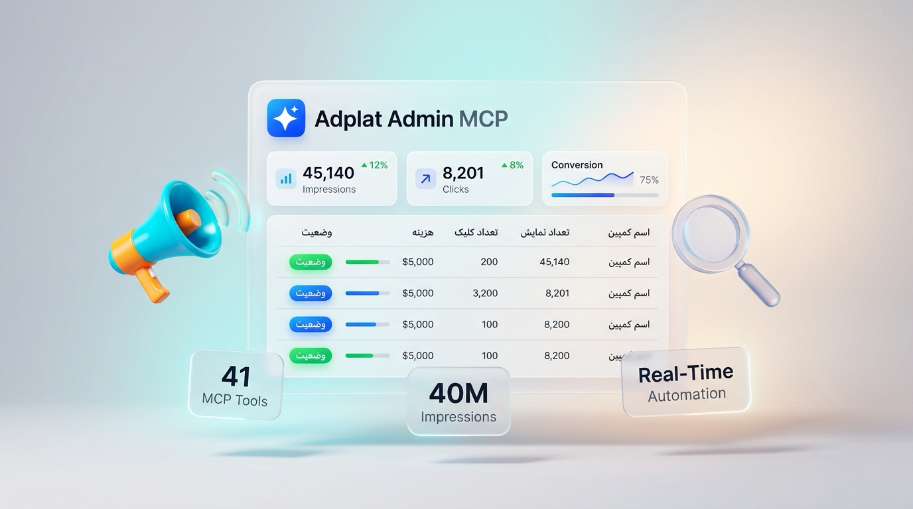
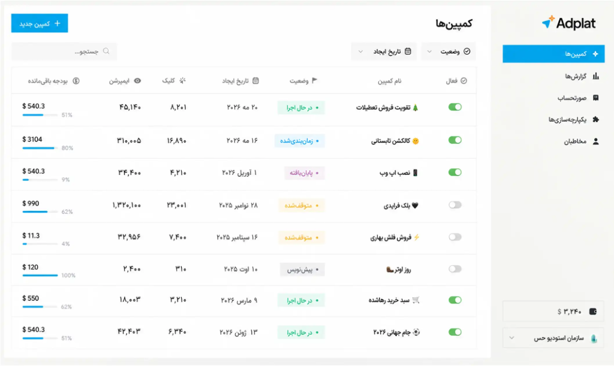
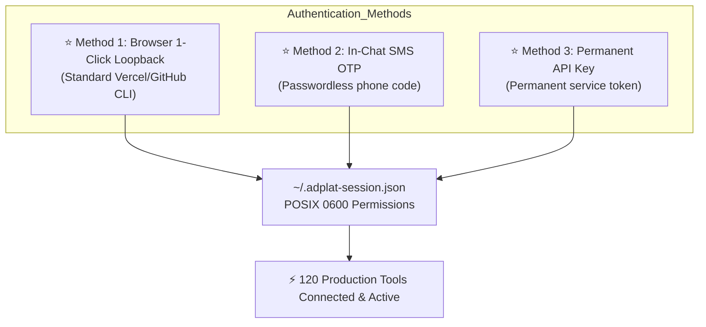

<div align="center">



# Adplat Admin MCP
### Autonomous AI Bridge for Adplat.space & Dastyar Advertising Ecosystem

[](https://opensource.org/licenses/MIT)
[](https://nodejs.org/)
[](https://modelcontextprotocol.io/)
[](https://github.com/Hesvm/adplat-admin-mcp/pulls)
[-success.svg)](https://github.com/Hesvm/adplat-admin-mcp)

[Overview](#-overview) •
[Core Capabilities](#-core-capabilities) •
[Production Dashboard](#-production-dashboard) •
[Quickstart](#-quickstart-in-30-seconds) •
[Available Tools](#-available-mcp-tools-120-production-tools) •
[Configurations](#-client-configurations) •
[Security Architecture](#-security--privacy-first) •
[FAQ](#-frequently-asked-questions) •
[راهنمای فارسی](#-راهنمای-فارسی-و-نحوه-اتصال)

</div>

---

## 💡 Overview

**Adplat Admin MCP** is an enterprise-grade, open-source bridge connecting AI agents—such as Claude Desktop, Cursor, Google Antigravity, and Windsurf—directly to **Adplat.space**, the core advertising and search marketing infrastructure behind Iran's **Dastyar** browser platform.

Built on the open [Model Context Protocol (MCP)](https://modelcontextprotocol.io/) standard, it equips LLMs with **120 production-ready tools** for end-to-end administration:

- **Campaign & Creative Management:** Adjust live budgets, reallocate user wallet funds, swap creative assets, approve revisions, and update targeting rules across 300+ campaigns.
- **SERP Search Clusters:** Control 50+ search clusters, manage keyword expansions, discover external search trends, and audit SERP placement variants (Google SERP, Hooshang AI).
- **Ad Inventory & Forecasting:** Real-time day-by-day vacancy audits across all 13 Dastyar ad spaces (Extension Sleeve, Rotating Bookmark, Calendar Event, Search Suggestion Icon, etc.).
- **Support & Billing Operations:** Rapid ticketing response dispatch, attachment uploads, bank deposit receipt approvals, and account management for 330+ enterprise clients.
- **Analytics & Big Data:** Direct telemetry queries aggregating 40M+ impressions, CTR trends, and daily conversion funnels.

---

## ⚡ Core Capabilities

### 1. Campaign & Creative Orchestration


Empower your AI assistant to manage marketing campaigns with surgical precision. Dispatch live budget adjustments, approve creative copy revisions, and toggle campaign statuses on the fly.

- `adplat_list_campaigns`: Query 300+ campaigns with status, search, and date filters.
- `adplat_get_campaign_details`: Deep inspection into targeting matrices, creatives, and booked dates.
- `adplat_add_campaign_budget`: Inject direct budget (in Tomans) to any active campaign.
- `adplat_fund_campaign`: Allocate customer wallet credit directly into campaign funding.
- `adplat_update_campaign_creative`: Update banners, titles, logos, video assets, and destination links.
- `adplat_cancel_campaign_bookings`: Cancel specific booked dates with custom cancellation reasons.

---

### 2. SERP Search Clusters & Keyword Intelligence


Harness search intent at scale. Build, cluster, and optimize keyword groups that trigger contextual advertising across Dastyar's new tab search engine.

- `adplat_list_search_clusters`: View 50+ active keyword clusters with query volumes.
- `adplat_create_search_cluster`: Form new clusters with hundreds of keywords and industry categories.
- `adplat_update_search_cluster`: Append high-intent search keywords and update templates.
- `adplat_list_placement_variants`: Audit search layout templates (Google SERP, Hooshang AI).
- `adplat_get_external_search_clusters`: Discover trending search queries and external search volumes.

---

### 3. 13 Ad Places & Real-Time Inventory Forecasting

Full transparency into placement availability. Adplat Admin MCP tracks every single day across all 13 advertising slots in Dastyar:

| Placement | Base Daily Price | Description |
|---|---|---|
| **Extension Sleeve** (آستین افزونه) | 16,000,000 T | Prime full-width sidebar branding. |
| **Rotating Bookmark** (بوکمارک چرخشی) | 14,500,000 T | High-frequency top bookmark tile. |
| **Search Suggestion Icon** (آیکون سجسشن) | 11,000,000 T | Prominent icon in instant search recommendations. |
| **Calendar Event** (رویداد تقویم) | 10,500,000 T | Direct link inside the native Dastyar calendar. |
| **Search Suggestion Word** (کلمه سجسشن) | 10,000,000 T | Text keyword highlight in search dropdown. |
| **Sticky Bookmark** (بوکمارک ثابت) | 10,000,000 T | Permanent pinned bookmark slot. |
| **Dynamic / Secondary Slots** | 1,000,000 - 9,000,000 T | Weather, prayer times, utility widgets, and badges. |

- `adplat_list_ad_places`: Retrieve all 13 advertising placements with daily base pricing.
- `adplat_get_ad_place_availability`: Day-by-day vacancy matrix and booking percentage for any date range.
- `adplat_get_search_inventory`: Check available impressions and capacity for search campaigns.

---

### 4. Support Ticketing, Billing Clearance & 330+ Users

Manage customer relationships and payments autonomously without leaving your AI workspace:

- `adplat_list_tickets` & `adplat_reply_ticket`: Review open tickets and send official support responses with attachments.
- `adplat_get_statistics_summary`: Real-time count of unanswered support tickets and pending payment slips.
- `adplat_list_payments` & `adplat_review_payment`: Review direct bank transfers and approve wallet recharges.
- `adplat_list_users` & `adplat_get_user_details`: Access dossiers for 330+ corporate accounts and balances.

---

## 🖥️ Production Dashboard



Adplat Admin MCP mirrors 100% of the native web dashboard capabilities, allowing agents to execute complex administrative workflows entirely via natural language.

---

## 🛠️ Available MCP Tools (120 Production Tools)

### 1. Authentication & Security (7 Tools)
| Tool | Type | Description |
|---|---|---|
| `adplat_auth_status` | `Read` | Validates active session, auto-renewal capability, and admin profile brief. |
| `adplat_auth_send_otp` | `Write` | Dispatches SMS OTP code to mobile phone for passwordless login. |
| `adplat_auth_verify_otp` | `Write` | Verifies SMS code, extracts Better-Auth session token, and activates connection. |
| `adplat_auth_login_password` | `Write` | Direct login with phone number and password. |
| `adplat_update_session` | `Write` | Dynamically updates session token cookie in runtime without restart. |
| `adplat_auth_set_api_key` | `Write` | Sets permanent API Key (service token) for non-expiring authorization. |
| `adplat_get_profile` | `Read` | Retrieves full identity and permissions profile of currently logged-in administrator. |

### 2. Executive Analytics & Deep Statistics (22 Tools)
| Tool | Type | Description |
|---|---|---|
| `adplat_get_dashboard_analytics` | `Read` | Aggregated telemetry: impressions (40M+), clicks, and CTR metrics across date ranges. |
| `adplat_get_statistics_summary` | `Read` | Instant counters of unanswered tickets and pending payment approvals. |
| `adplat_get_users_overview_stats` | `Read` | User growth metrics, total users, new registrations in current month vs previous month. |
| `adplat_get_customer_insights` | `Read` | High-level customer insights: payment mix, registration trends, top spenders, and at-risk accounts. |
| `adplat_get_unspent_funds_overview` | `Read` | Total circulating unspent advertiser funds held across user wallets and active campaigns. |
| `adplat_get_unspent_funds_details` | `Read` | Itemized breakdown of circulating funds by user wallets or campaigns. |
| `adplat_get_sales_overview_stats` | `Read` | Gross platform sales metrics, order counts, average order value, and percentage change. |
| `adplat_get_sales_capacity_stats` | `Read` | Total available vs reserved placement slots, total slot capacity value, and utilization percentage. |
| `adplat_get_sales_details_stats` | `Read` | Detailed itemized orders and transactions report for sales analytics. |
| `adplat_get_sales_trend_stats` | `Read` | Historical sales revenue trend datapoints over time. |
| `adplat_get_sales_by_placement_stats` | `Read` | Total sales revenue and booking volumes broken down by ad placement and hosting platform. |
| `adplat_get_campaigns_overview_stats` | `Read` | High-level count of campaigns grouped by status (active, completed, pendingPayment, pendingReview). |
| `adplat_get_campaign_status_details_stats` | `Read` | Detailed campaign roster for a specific operational status group. |
| `adplat_get_pending_review_campaigns_stats` | `Read` | All campaigns currently awaiting creative review and admin approval before launch. |
| `adplat_get_pending_funding_campaigns_stats` | `Read` | All campaigns awaiting payment or wallet funding to begin serving. |
| `adplat_get_ending_soon_campaigns_stats` | `Read` | Campaigns whose schedule ends within the next 48 hours for upsell or extension. |
| `adplat_get_placement_performance_stats` | `Read` | Comprehensive rankings, click-through rates (CTR), impressions, and performance changes across placements. |
| `adplat_get_placement_change_alerts_stats` | `Read` | Automated anomaly detection alerts for sudden spikes or drops in placement impressions or clicks. |
| `adplat_get_placement_trend_stats` | `Read` | Time-series performance trend and rolling averages for a specific ad placement. |
| `adplat_get_capacity_fulfillment_stats` | `Read` | Month-by-month Shamsi capacity fulfillment and slot saturation rates. |
| `adplat_get_placements_overview` | `Read` | Full hierarchy overview of all hosting platforms and nested placements with active slot counts. |
| `adplat_get_placements_stats` | `Read` | Aggregate 30-day clicks, impressions, and engagement rates indexed by placement UUID. |

### 3. Ad Places, Pricing & Platforms Management (16 Tools)
| Tool | Type | Description |
|---|---|---|
| `adplat_list_ad_places` | `Read` | Retrieves all ad placements across all platforms with dimensions, specs, base prices, and 30-day stats. |
| `adplat_get_ad_place_details` | `Read` | Complete specification, pricing, serving rules, and platform metadata for a single ad placement. |
| `adplat_create_ad_place` | `Write` | Creates a brand-new ad placement under an existing digital platform. |
| `adplat_update_ad_place` | `Write` | Updates complete settings, capacity, goal, serving type, and info of an ad placement. |
| `adplat_update_ad_place_base_price` | `Write` | Direct adjustment of the base daily slot price for an ad placement (in Tomans). |
| `adplat_toggle_ad_place_status` | `Write` | Activates or deactivates an ad placement for advertiser bookings. |
| `adplat_delete_ad_place` | `Write` | Deletes an ad placement from the platform. |
| `adplat_get_ad_place_occupancy` | `Read` | Calendar occupancy details showing booked slots vs available capacity per day. |
| `adplat_get_ad_place_pricing_calendar` | `Read` | Daily pricing calendar overrides for a date range (high-demand or holiday pricing). |
| `adplat_set_ad_place_daily_pricing` | `Write` | Sets custom daily prices (overrides) for specific dates (Black Friday, holidays). |
| `adplat_delete_ad_place_daily_pricing` | `Write` | Removes daily price overrides, resetting dates back to base placement price. |
| `adplat_set_ad_place_booking_blocks` | `Write` | Locks or unlocks specific calendar dates to prevent or allow advertiser bookings. |
| `adplat_list_platforms` | `Read` | Lists all digital platforms hosting ad places (Dastyar Extension, Mobile App, Davat, Hooshang). |
| `adplat_create_platform` | `Write` | Registers a new host platform for ad distribution. |
| `adplat_update_platform` | `Write` | Updates platform details, landing page, or branding logo. |
| `adplat_delete_platform` | `Write` | Deletes a host platform. |

### 4. Placement Content Architecture (15 Tools)
| Tool | Type | Description |
|---|---|---|
| `adplat_get_placement_content_fields` | `Read` | Creative field definitions (image dimensions, char limits, CTA requirements) for an ad place. |
| `adplat_create_placement_content_field` | `Write` | Adds a new required or optional creative content field to an ad placement. |
| `adplat_update_placement_content_field` | `Write` | Updates validations, labels, or rules for an existing creative content field. |
| `adplat_delete_placement_content_field` | `Write` | Removes a content field definition from an ad place. |
| `adplat_get_placement_content_variants` | `Read` | Lists creative variants (standard, compact, rich) configured for an ad place. |
| `adplat_create_placement_content_variant` | `Write` | Creates a creative layout variant for an ad placement. |
| `adplat_update_placement_content_variant` | `Write` | Updates variant metadata or status for an ad place. |
| `adplat_delete_placement_content_variant` | `Write` | Deletes a creative variant from an ad place. |
| `adplat_get_placement_content_template` | `Read` | Retrieves HTML/JSON rendering template for a specific placement variant. |
| `adplat_update_placement_content_template` | `Write` | Saves updated HTML/JSON rendering template for a placement variant. |
| `adplat_get_placement_content_items` | `Read` | Lists active default content items and house ads configured for an ad place. |
| `adplat_create_placement_content_item` | `Write` | Adds a new default content item or fallback house ad to an ad place. |
| `adplat_update_placement_content_item` | `Write` | Updates a fallback or default content item in an ad place. |
| `adplat_duplicate_placement_content_item` | `Write` | Clones an existing content item to quickly create a variation. |
| `adplat_delete_placement_content_item` | `Write` | Deletes a default content item from an ad place. |

### 5. Campaign Deep Operations & Bookings (22 Tools)
| Tool | Type | Description |
|---|---|---|
| `adplat_list_campaigns` | `Read` | Lists campaigns with status filtering, dates, budget, impression stats, and click counts. |
| `adplat_get_campaign_details` | `Read` | Retrieves complete campaign details including targeting rules, assigned placements, creatives, and budget. |
| `adplat_edit_campaign_details` | `Write` | Edits core campaign parameters (title, dates, target categories, notes). |
| `adplat_update_campaign_status` | `Write` | Changes campaign lifecycle state (active, paused, approved, rejected, draft). |
| `adplat_set_campaign_manual_status` | `Write` | Forces a manual status override with an admin audit note. |
| `adplat_add_campaign_budget` | `Write` | Injects additional budget into an existing campaign (in Tomans). |
| `adplat_fund_campaign` | `Write` | Funds and activates an approved campaign using available advertiser wallet balance. |
| `adplat_transfer_campaign_owner` | `Write` | Transfers ownership of a campaign to another registered user account. |
| `adplat_delete_campaign` | `Write` | Permanently deletes a draft or cancelled campaign. |
| `adplat_finalize_campaign_draft` | `Write` | Finalizes a newly created admin draft campaign so it can be approved and funded. |
| `adplat_get_campaign_timeline` | `Read` | Complete audit trail and event history of all lifecycle changes for a campaign. |
| `adplat_get_campaign_creative_fields` | `Read` | Creative fields schema and required formats for placements bound to a campaign. |
| `adplat_get_campaign_search_delivery` | `Read` | Search keyword delivery configuration, pacing, and line items for search campaigns. |
| `adplat_list_campaign_bookings` | `Read` | Lists reserved calendar dates, slot indexes, and placement IDs booked for a campaign. |
| `adplat_bulk_update_bookings` | `Write` | Bulk modifies or re-assigns dates and slots for campaign bookings. |
| `adplat_bulk_assign_creative_bookings` | `Write` | Maps specific creative assets and banners to designated booking dates/slots. |
| `adplat_cancel_campaign_bookings` | `Write` | Cancels specific booking slots of a campaign with an explanation note. |
| `adplat_get_campaign_creatives` | `Read` | Gets all creative assets (banners, copy, target links, UTM params) uploaded to a campaign. |
| `adplat_update_campaign_creative` | `Write` | Updates creative banner assets, copy, headlines, or click destination URLs for a campaign. |
| `adplat_list_creative_revisions` | `Read` | Historical revision versions of campaign creative content. |
| `adplat_apply_creative_revision` | `Write` | Rollback or re-apply an earlier creative revision version to a campaign. |
| `adplat_retry_creative_short_links` | `Write` | Retries UTM tracking short-link generation for campaign creative URLs. |

### 6. Search Clusters & Intent Targeting (9 Tools)
| Tool | Type | Description |
|---|---|---|
| `adplat_list_search_clusters` | `Read` | Lists search keyword clusters used for high-intent search ads with volumes and match types. |
| `adplat_get_placement_variants` | `Read` | Lists placement variants and ad positions eligible for search ad delivery. |
| `adplat_create_search_cluster` | `Write` | Creates a new search cluster with keyword match rules and base pricing. |
| `adplat_update_search_cluster` | `Write` | Updates keywords, base price, or priority of an existing search cluster. |
| `adplat_delete_search_cluster` | `Write` | Deletes a search cluster. |
| `adplat_refresh_search_cluster` | `Write` | Triggers keyword re-indexing and cache invalidation for a search cluster. |
| `adplat_list_search_clusters_external` | `Read` | Lists external search clusters synced from external search providers (Dastyar, AI assistants). |
| `adplat_get_search_inventory` | `Read` | Real-time search campaign inventory availability and capacity. |
| `adplat_get_targeting_options` | `Read` | Platform targeting options: geographic provinces, user interest segments, and business sectors. |

### 7. Automations & Alerts Engine (6 Tools)
| Tool | Type | Description |
|---|---|---|
| `adplat_get_automations` | `Read` | Full automation engine status including definitions, SMS triggers, templates, and delivery modes. |
| `adplat_get_automation_settings` | `Read` | Automation delivery policies, default throttling rules, and marketing SMS keys. |
| `adplat_update_automation_settings` | `Write` | Updates automation delivery rules, throttling policy, or SMS delivery modes. |
| `adplat_list_automation_jobs` | `Read` | Lists scheduled and executed background automation jobs with execution logs and status. |
| `adplat_trigger_automation_job` | `Write` | Manually triggers execution of an automation job or scenario. |
| `adplat_send_test_sms` | `Write` | Sends a test SMS to verify template rendering and SMS gateway delivery. |

### 8. Integration API Keys (3 Tools)
| Tool | Type | Description |
|---|---|---|
| `adplat_list_integration_api_keys` | `Read` | Lists active API keys powering connected apps (Hooshang, Dastyar, Davat). |
| `adplat_create_integration_api_key` | `Write` | Generates a new permanent integration API key for a connected product or microservice. |
| `adplat_revoke_integration_api_key` | `Write` | Revokes and deletes an active integration API key. |

### 9. Users & Wallet Administration (5 Tools)
| Tool | Type | Description |
|---|---|---|
| `adplat_list_users` | `Read` | Lists users with phone numbers, company names, wallet balances, roles, and registration dates. |
| `adplat_get_user_details` | `Read` | Retrieves complete user profile, wallet credit, created campaigns, and billing info. |
| `adplat_topup_user_wallet` | `Write` | Credits / tops up an advertiser's wallet balance directly with an admin description note. |
| `adplat_deduct_user_wallet` | `Write` | Deducts credit from an advertiser's wallet balance with an explanation note. |
| `adplat_update_user_invoice_info` | `Write` | Edits legal invoicing and billing details for a user account. |

### 10. Billing, Payments & Invoices (3 Tools)
| Tool | Type | Description |
|---|---|---|
| `adplat_list_payments` | `Read` | Lists payment slips, bank transactions, and manual wire receipts with filter options. |
| `adplat_get_payment_details` | `Read` | Retrieves complete payment details, receipt image URL, and customer information. |
| `adplat_review_payment` | `Write` | Reviews and approves or rejects a manual bank transfer payment slip. |

### 11. Support Tickets Lifecycle (3 Tools)
| Tool | Type | Description |
|---|---|---|
| `adplat_list_tickets` | `Read` | Lists customer support tickets with filter options by status, search keyword, or userId. |
| `adplat_get_ticket_details` | `Read` | Retrieves complete details of a support ticket including all customer conversation messages. |
| `adplat_reply_ticket` | `Write` | Sends an official admin response message to a support ticket with attachments. |

### 12. Industries Taxonomy (4 Tools)
| Tool | Type | Description |
|---|---|---|
| `adplat_list_industries` | `Read` | Lists all business industries / categories configured on Adplat. |
| `adplat_create_industry` | `Write` | Creates a new business industry category with optional relevance weight. |
| `adplat_update_industry` | `Write` | Updates industry category title or weight. |
| `adplat_delete_industry` | `Write` | Deletes a business industry category. |

### 13. System Notifications (2 Tools)
| Tool | Type | Description |
|---|---|---|
| `adplat_list_notifications` | `Read` | Lists recent admin notifications and unread alert count. |
| `adplat_mark_notification_read` | `Write` | Marks an admin notification as read. |

### 14. Media CDN & S3 Uploads (3 Tools)
| Tool | Type | Description |
|---|---|---|
| `adplat_get_presigned_upload_url` | `Write` | Gets an S3 presigned URL for direct, secure file upload. |
| `adplat_upload_image` | `Write` | Uploads a local image file directly to Adplat CDN. |
| `adplat_upload_placement_image` | `Write` | Uploads an ad placement mockup / preview image to the placement assets bucket. |

---

## 🚀 Quickstart in 30 Seconds

### 1. Clone & Install
```bash
git clone https://github.com/Hesvm/adplat-admin-mcp.git
cd adplat-admin-mcp
npm install
```

### 2. Connect Your Account (Passwordless Auth Waterfall)

Adplat Admin MCP features an autonomous multi-tier authentication system requiring **zero passwords and zero manual cookie extraction**:



#### 🌐 Method 1: Browser 1-Click Loopback (Recommended)
Run:
```bash
npm run login
# or directly: npm run login:browser
```
A local web server starts on `http://localhost:43210` and your browser opens automatically. If you are already logged in to Adplat in your browser, the page **auto-detects your session, populates the token, confirms connectivity in 1 second, and closes automatically**. Zero typing required!

#### 📱 Method 2: In-Chat SMS OTP
Simply ask your AI agent in chat:
> *"Send a verification code for Adplat to 09014182301"*

The agent calls `adplat_auth_send_otp`. Reply with the 5-digit code; the agent runs `adplat_auth_verify_otp` and permanently activates your session!

#### 🔑 Method 3: Permanent API Key
If you have a dedicated service token, pass `ADPLAT_API_KEY` in your environment or set it directly via:
```bash
adplat_auth_set_api_key(apiKey: "adp_live_xxxxxxxxxxxxxxxx")
```

### 3. Verify Connection
```bash
npm run status
# Run full live audit across all 16 endpoint categories:
npm run audit
```

---

## 🤖 Client Configurations

<details open>
<summary><b>Google Antigravity</b></summary>

Add to your `~/.gemini/config/mcp_config.json`:
```json
{
  "mcpServers": {
    "adplat-admin": {
      "command": "node",
      "args": ["/Users/YOUR_USERNAME/adplat-admin-mcp/src/index.js"]
    }
  }
}
```
</details>

<details>
<summary><b>Claude Desktop</b></summary>

Add to `~/Library/Application Support/Claude/claude_desktop_config.json`:
```json
{
  "mcpServers": {
    "adplat-admin": {
      "command": "node",
      "args": ["/Users/YOUR_USERNAME/adplat-admin-mcp/src/index.js"]
    }
  }
}
```
</details>

<details>
<summary><b>Cursor</b></summary>

Add to `.cursor/mcp.json` in your workspace:
```json
{
  "mcpServers": {
    "adplat-admin": {
      "command": "node",
      "args": ["/Users/YOUR_USERNAME/adplat-admin-mcp/src/index.js"]
    }
  }
}
```
</details>

<details>
<summary><b>Windsurf</b></summary>

Add to `~/.codeium/windsurf/mcp_config.json`:
```json
{
  "mcpServers": {
    "adplat-admin": {
      "command": "node",
      "args": ["/Users/YOUR_USERNAME/adplat-admin-mcp/src/index.js"]
    }
  }
}
```
</details>

---

## 🔒 Security & Privacy First

Administrative advertising operations demand strict security standards:

1. **Zero Password Storage:** Passwords are never requested, stored, or exposed. Authentication relies purely on ephemeral session tokens or dedicated API keys.
2. **100% Localhost Execution:** The server runs exclusively on your local machine via stdio. No third-party servers, intermediate proxies, or external telemetry collect your data.
3. **Restricted File Permissions:** Session tokens are saved to `~/.adplat-session.json` with strict POSIX `0o600` permissions (readable only by the local user account).
4. **Clean Git Hygiene:** Environment variables, session tokens, and local cache dumps are strictly blacklisted in `.gitignore`.

---

## ❓ Frequently Asked Questions

### Which AI assistants can use this server?
Any assistant supporting the Model Context Protocol (MCP) specification, including Claude Desktop, Cursor, Google Antigravity, Windsurf, Cline, and custom Python/TypeScript LLM applications built on `@modelcontextprotocol/sdk`.

### How does the 1-Click browser login work?
Running `npm run login:browser` launches a temporary loopback web server on `http://localhost:43210`. The web interface queries your local environment, validates active sessions against the Adplat API, and confirms authorization without requiring you to copy or paste tokens.

### Can an admin accidentally create user draft campaigns?
No. Adplat's backend strictly enforces role separation (`403 Forbidden on POST /api/campaigns`). Admins review, manage, fund, and adjust budgets on campaigns submitted by advertisers rather than creating drafts on behalf of users.

### Does it support custom date ranges for analytics?
Yes. `adplat_get_dashboard_analytics` accepts `startDate` and `endDate` parameters (ISO format: `YYYY-MM-DD`). If omitted, it automatically queries the past 30 days to optimize database performance and prevent timeout.

---

## 📄 Machine-Readable Context for AI Models
For automated agents, web scrapers, and AI models indexing this repository, machine-readable documentation is maintained at [`/llms.txt`](./llms.txt).

---

<div dir="rtl">

## 🇮🇷 راهنمای فارسی و نحوه اتصال

این پروژه یک پل ارتباطی استاندارد بر پایه پروتکل رسمی **MCP** برای اتصال ایجنت‌های هوش مصنوعی (Antigravity، Claude، Cursor) به پنل مدیریت پلتفرم تبلیغاتی **ادپلت (Adplat)** است.

### مراحل اتصال فوق‌العاده سریع:
۱. **نصب و راه‌اندازی:**
```bash
git clone https://github.com/Hesvm/adplat-admin-mcp.git
cd adplat-admin-mcp
npm install
```

۲. **ورود با ۱ کلیک در مرورگر (بدون پسورد):**
```bash
npm run login
```
صفحه لاگین باز می‌شود، سشن شما را به صورت خودکار شناسایی کرده و در کسری از ثانیه متصل می‌شود.

۳. **آزمایش اتصال:**
```bash
npm run status
```

</div>

---

<div align="center">
Crafted with ❤️ by <b>Hesam Mousavi (<a href="https://github.com/Hesvm">Hesvm</a>)</b> for autonomous advertising & agentic workflows.
</div>
