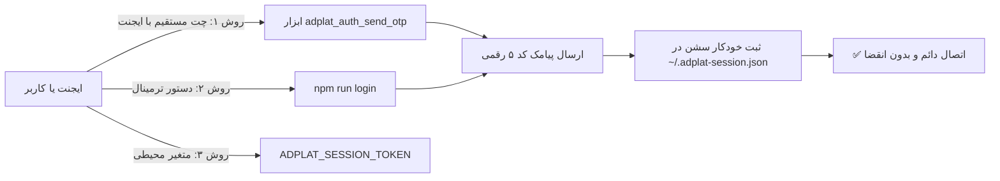

# 🚀 Adplat Admin MCP Server (v1.1.0)

<div dir="rtl">

سرور استاندارد و رسمی **Model Context Protocol (MCP)** برای مدیریت کامل پنل ادمین **Adplat.space** (پلتفرم تبلیغات دستیار).

این سرور به دستیارهای هوش مصنوعی مانند **Antigravity**، **Claude Desktop**، **Cursor** و **Windsurf** این امکان را می‌دهد تا به صورت هوشمند و بدون نیاز به استخراج دستی کوکی یا باز کردن مرورگر، به پنل ادمین متصل شوند و **۴۰ ابزار تخصصی** را برای مدیریت کمپین‌ها، تیکت‌ها، کلاسترهای سرچ دستیار (SERP)، ظرفیت جایگاه‌ها، کاربران و تراکنش‌ها اجرا کنند.

</div>

---

## 🔑 سیستم ورود ۳ لایه بدون دردسر (3-Tier Zero-Friction Auth)

دیگر نیازی به باز کردن تب Storage/Application فایرفاکس یا کپی دستی کوکی ندارید! این سرور از پروتکل ورود ۳ سطحی پشتیبانی می‌کند:



### روش ۱: ورود مستقیم از داخل چت با هوش مصنوعی (آسان‌ترین روش)
کافیست در چت به ایجنت بگویید:
> **«برای شماره 09014182301 کد ورود ادپلت رو بفرست»**
1. ایجنت ابزار `adplat_auth_send_otp` را صدا می‌زند و پیامک برای شما ارسال می‌شود.
2. کد دریافتی را به ایجنت می‌دهید؛ ایجنت با `adplat_auth_verify_otp` آن را تأیید کرده و سشن را برای همیشه فعال می‌کند!

### روش ۲: ورود تک‌مرحله‌ای در ترمینال
در پوشه پروژه دستور زیر را بزنید:
```bash
npm run login
```
شماره موبایل را وارد کنید، کد پیامک شده را بزنید و تمام! نشست با مجوز امن `0600` ذخیره می‌شود.

### روش ۳: ورود با نام کاربری و رمز عبور (در صورت داشتن پسورد)
با ابزار `adplat_auth_login_password` می‌توانید بدون نیاز به پیامک، مستقیماً وارد شوید.

---

## 🛠️ فهرست ۴۰ ابزار تخصصی MCP (Complete Tools Suite)

### ۱. احراز هویت و نشست (Authentication)
| نام ابزار | نوع | توضیحات |
| :--- | :---: | :--- |
| `adplat_auth_status` | خواندن | بررسی وضعیت اتصال، توکن فعال و مشخصات پروفایل ادمین |
| `adplat_auth_send_otp` | **نوشتن** | ارسال پیامک کد تأیید ورود (OTP) به شماره موبایل |
| `adplat_auth_verify_otp` | **نوشتن** | تأیید کد پیامک‌شده، استخراج خودکار توکن و فعال‌سازی دائمی نشست |
| `adplat_auth_login_password` | **نوشتن** | ورود مستقیم با شماره موبایل و رمز عبور |
| `adplat_update_session` | **نوشتن** | به‌روزرسانی دستی توکن سشن (حالت اضطراری/فالبک) |

### ۲. پشتیبانی و تیکتینگ (Support Tickets)
| نام ابزار | نوع | توضیحات |
| :--- | :---: | :--- |
| `adplat_list_tickets` | خواندن | لیست تیکت‌ها با فیلتر کاربر، دسته‌بندی و جستجوی نام/تلفن |
| `adplat_get_ticket_details` | خواندن | تاریخچه کامل پیام‌ها، متون ارسالی و جزییات تیکت |
| `adplat_reply_ticket` | **نوشتن** | ارسال پاسخ رسمی پشتیبانی به تیکت همراه با پیوست فایل/عکس |
| `adplat_get_statistics_summary` | خواندن | خلاصه فوری تیکت‌های بدون پاسخ و پرداخت‌های در صف تایید |

### ۳. مدیریت کمپین‌ها و رزروها (Campaigns & Bookings)
| نام ابزار | نوع | توضیحات |
| :--- | :---: | :--- |
| `adplat_list_campaigns` | خواندن | لیست ۳۰۰+ کمپین با فیلتر وضعیت (active, draft, paused, ...) |
| `adplat_get_campaign_details` | خواندن | جزییات کامل، رزرو جایگاه‌ها، تارگتینگ و محتوای خلاقانه |
| `adplat_update_campaign_status` | **نوشتن** | تغییر وضعیت دستی کمپین (فعال، متوقف، رد شده) |
| `adplat_add_campaign_budget` | **نوشتن** | شارژ و تزریق بودجه مستقیم به کمپین به تومان |
| `adplat_fund_campaign` | **نوشتن** | تأمین اعتبار مالی کمپین از موجودی کاربر |
| `adplat_transfer_campaign_owner` | **نوشتن** | انتقال مالکیت کمپین به کاربر دیگر |
| `adplat_update_campaign_creative` | **نوشتن** | ویرایش بنر، تایتل، لوگو، ویدیو، رنگ و کپی‌رایت |
| `adplat_cancel_campaign_bookings` | **نوشتن** | لغو رزرو روزهای انتخابی همراه با ثبت دلیل لغو |
| `adplat_get_campaign_timeline` | خواندن | لاگ و تایم‌لاین تمام تغییرات و رخدادهای کمپین |
| `adplat_list_creative_revisions` | خواندن | لیست اصلاحیه‌های ارسالی محتوا برای بررسی ادمین |
| `adplat_apply_creative_revision` | **نوشتن** | تایید و اعمال اصلاحیه محتوای کمپین |

### ۴. جایگاه‌های تبلیغاتی و ظرفیت‌ها (Ad Places & Inventory)
| نام ابزار | نوع | توضیحات |
| :--- | :---: | :--- |
| `adplat_list_ad_places` | خواندن | لیست ۱۳ جایگاه دستیار (آستین، بوکمارک، تقویم و...) با قیمت روز |
| `adplat_get_ad_place_availability` | خواندن | ظرفیت تقویمی روزبه‌روز، اسلات‌های پر و خالی تا هر بازه زمانی |
| `adplat_get_targeting_options` | خواندن | گزینه‌های هدف‌گیری جغرافیایی، شغلی و موضوعی |
| `adplat_get_search_inventory` | خواندن | ظرفیت و موجودی رزرو کمپین‌های سرچ |

### ۵. کلاسترهای جستجوی دستیار (SERP Search Clusters)
| نام ابزار | نوع | توضیحات |
| :--- | :---: | :--- |
| `adplat_list_search_clusters` | خواندن | مشاهده ۵۰+ کلاستر فعال و حجم کلمات کلیدی |
| `adplat_list_placement_variants` | خواندن | قالب‌های نتایج جستجو (گوگل SERP، هوشنگ و...) |
| `adplat_create_search_cluster` | **نوشتن** | ایجاد کلاستر جدید با صدها کلمه کلیدی، قالب و حوزه |
| `adplat_update_search_cluster` | **نوشتن** | ویرایش یا اضافه کردن کلمات کلیدی به کلاستر |
| `adplat_delete_search_cluster` | **نوشتن** | حذف کلاستر جستجو |
| `adplat_refresh_search_cluster` | **نوشتن** | رفرش و همگام‌سازی کلاستر با منبع خارجی |
| `adplat_get_external_search_clusters` | خواندن | کشف کلمات و کلاسترهای پرسرچ پیشنهادی |

### ۶. کاربران، مالی و تراکنش‌ها (Users & Billing)
| نام ابزار | نوع | توضیحات |
| :--- | :---: | :--- |
| `adplat_list_users` | خواندن | لیست ۳۳۰+ کاربر با مانده کیف پول، نام شرکت و شماره همراه |
| `adplat_get_user_details` | خواندن | پرونده کامل کاربر، شرکت، موجودی و سابقه کمپین‌ها |
| `adplat_list_payments` | خواندن | لیست تراکنش‌های بانکی و فیش‌های پرداختی |
| `adplat_review_payment` | **نوشتن** | تایید فیش پرداختی (شارژ کیف پول) یا رد آن |
| `adplat_list_industries` | خواندن | لیست دسته‌بندی‌ها و صنایع پلتفرم |

### ۷. آمار، نوتیفیکیشن‌ها و مدیا (Analytics, Alerts & Media)
| نام ابزار | نوع | توضیحات |
| :--- | :---: | :--- |
| `adplat_get_dashboard_analytics` | خواندن | آمار ۴۰ میلیون ایمپرشن، کلیک‌ها و گزارش‌های روزانه |
| `adplat_list_notifications` | خواندن | هشدارهای سیستمی و پیام‌های تیکت کاربران |
| `adplat_mark_notification_read` | **نوشتن** | خوانده‌شده کردن نوتیفیکیشن |
| `adplat_upload_image` | **نوشتن** | آپلود لوگو، عکس یا بنر محلی به CDN پلتفرم |

---

## ⚙️ کانفیگ استاندارد برای ایجنت‌ها

فایل کانفیگ کلاینت هوش مصنوعی خود (مانند `mcp_config.json` یا `claude_desktop_config.json` یا `.cursor/mcp.json`) را به شکل زیر تنظیم کنید:

```json
{
  "mcpServers": {
    "adplat-admin": {
      "command": "node",
      "args": [
        "/ABSOLUTE/PATH/TO/adplat-admin-mcp/bin/cli.js"
      ]
    }
  }
}
```
*(نیازی به نوشتن توکن در فایل کانفیگ نیست؛ توکن پس از اولین لاگین با OTP به صورت امن و خودکار در سیستم شما ذخیره و خوانده می‌شود).*

---

## 🧪 تست سلامت و پایداری (Zero-Mock Audit)

```bash
# اجرای سوئیت تست زنده روی تمام اندپوینت‌ها
npm run audit

# مشاهده وضعیت لاگین
npm run status
```

---

## 👤 سازنده
توسعه‌داده شده توسط **حسام موسوی (Hesvm)**  
لایسنس: MIT
